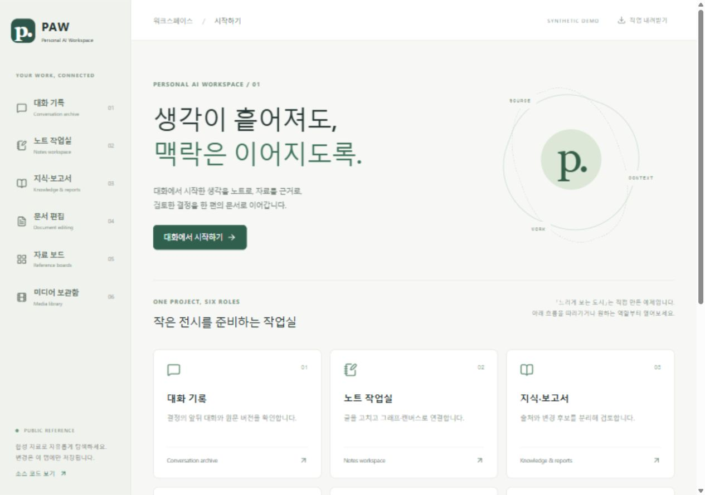

# Personal AI Workspace (PAW)

**Keep the source. Connect the context. Continue the work.**

[한국어](README.ko.md) · [Architecture](docs/ARCHITECTURE.md) · [Evidence & limits](docs/CV-EVIDENCE.md) · [Sites deployment](docs/DEPLOY-SITES.md)

PAW is an AI-assisted collection of personal tools for conversations, notes, knowledge, documents, visual references and media. This repository publishes selected implementation modules and an interactive six-role reference demo with entirely synthetic content.

The underlying applications remain independent, with their own data models and storage. This static demo composes selected behaviors; it is not a shared production database, autonomous agent, or copy of private workspaces.



## Run it

Requires Node.js 22.13 or newer.

```sh
npm ci
npm test
npm run build
npm start
```

Open `http://127.0.0.1:4173`. No account, API key, database or private repository is required. The document engine loads when its role opens. Notes, canvas, report reviews and board state stay in this tab; unsaved note drafts also have browser-local recovery records. Download edits before closing the tab. Document edits stay in memory and must be downloaded before leaving that role.

## Six roles, one example project

The demo follows an authored exhibition project, “A slower look at the city.”

| Role | Try it | Existing implementation reused |
| --- | --- | --- |
| Conversation archive | Search messages, inspect surrounding turns, open a fixed revision link | Unicode-safe search/highlights, routes and context |
| Notes workspace | Edit linked notes, inspect the live graph, add canvas cards, recover an unsaved draft | Metadata/query, graph UI/simulation, JSON Canvas, immutable draft journal |
| Knowledge & reports | Record a source observation, review a proposal, see a stale proposal refused | Evidence/proposal contract; new public browser transitions |
| Document editing | Edit body/table text, render page 1, download and reopen HWPX | Structured staging, preservation checks, patched MIT WASM |
| Reference boards | Organize authored images, mark favorites, create boards and add notes | Board/item/section validation |
| Media library | Search annotations, seek video to 2 seconds, open a carousel image | Corpus matching and player/carousel controls |

AI suggestions and media annotations are **authored examples**. The demo does not call a model, collect social-media content or connect to a personal account.

## Source layout

```text
components/       Selected implementation, organized by role
src/              Public UI, synthetic fixtures and explicit adapters
assets/           Original SVG illustrations and synthetic WebM clip
tests/            Behavioral and real-WASM checks
scripts/          Build, preview, boundary checks and transfer preparation
docs/             Architecture, provenance, validation, claims and deployment
sites/            Account-neutral hosting template
licenses/         Retained third-party notices
provenance.json   Original/selected hashes and adaptation notes
```

See [provenance](docs/PROVENANCE.md) for exact-copy versus adapted code. The HWP/HWPX engine is based on [rhwp](https://github.com/edwardkim/rhwp), with retained patches and MIT attribution; the project does not claim engine authorship from scratch. Some selected library helpers are included for inspection but not enabled in the public UI.

## Verification

`npm test` exercises source search, fixed links, graph connections, canvas preservation, YAML edits, draft recovery/quota failure, knowledge validation, stale/idempotent proposal application, board membership, media search, MCP contracts and actual HWPX export/reopen. A failed structured document batch leaves the original bytes unchanged.

`npm run check:public` verifies selected source hashes and scans for known private paths, hostnames and credentials. This is a safeguard, not a proof that arbitrary future additions are safe. [Validation record](docs/VALIDATION.md) separates automated checks, browser checks and untested boundaries. GitHub Actions remain paused; no remote CI pass is claimed.

## Local MCP example

After building, configure a stdio MCP client to run `node <absolute-checkout-path>/dist/mcp.mjs`. Six `read_<role>` tools and `search_conversations` read authored fixtures only. They do not read browser edits, parse the live document, write to private apps or invoke an AI model. The browser does not need this process.

## Public release status

**Executable reference source · 2026-10-29.** This change replaces the documentation-only overview with runnable code and reproducible examples. A live public Site URL is not yet claimed.

Run `npm run package:sites` for an account-neutral static transfer directory, then follow the [secondary-account handoff](docs/DEPLOY-SITES.md). Registration/publication must use that account's Sites connection. The prepared directory is not an authenticated deployment archive or a successful deployment receipt.

[CV evidence](docs/CV-EVIDENCE.md) provides supported wording and excludes unverified claims such as complete document compatibility, live collectors, always-on cloud execution, OCR/ASR inference and the historical private 8-page/16-cell check. [Development sequence](docs/ARCHITECTURE.md#further-development) records remaining work.

Project-authored code and assets: MIT. Third-party components retain their own licenses.
