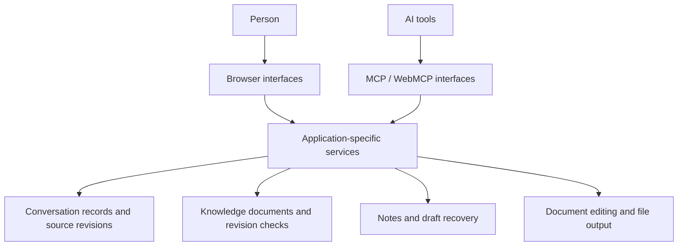

# Personal AI Workspace (PAW)

**Personal tools for keeping conversations, knowledge and documents useful to both people and AI.**

[한국어](README.ko.md) · [Author](https://github.com/juho-kim-dev)

PAW is a collection of independently developed web applications. It addresses a recurring problem in my own work: useful material is scattered across AI conversations, notes and files, and becomes difficult to find or safely edit later.

I develop these tools with AI assistance, working on application behavior, data preservation, tool interfaces and verification. Each application retains its own data model and storage; PAW is not a single shared database or a finished end-to-end autonomous platform.

## What I built

| Area | Implementation focus | Why it matters |
| --- | --- | --- |
| Conversation archive | Import public ChatGPT share links, preserve source revisions and message links, search and read through browser and MCP/WebMCP interfaces | People and AI can return to the same source and its context |
| Resumable collection | Persist collection state and handle retries without duplicating imports | Interrupted work can continue without starting over |
| Knowledge editing | Bind edit proposals to a document revision and reject stale proposals | An older edit cannot silently overwrite a newer version |
| Note recovery | Preserve unsaved drafts and check the original content and revision before restoring | Conflicting work can be retained separately instead of overwriting the server copy |
| Document editing | Extend an open-source HWP/HWPX editor with shared UI and AI commands; check saved documents by reopening them | Editing and tool calls follow the same document operations |

Features belong to different applications; availability and read/write permissions vary by application.

## Design overview

This is a conceptual view of the collection. The services and data stores are separate; support for an interface in one application does not imply support in every application.

## Engineering examples

- **A retry after interruption:** resume a persisted collection job and recognize already imported material.
- **A proposal based on an old document:** compare its base revision with the current document and reject the stale update.
- **An unsaved draft after a server failure:** preserve the local draft, then restore only after checking the original content and revision; retain a separate copy when they differ.
- **A document save:** reopen the output and compare text, tables and selected formatting. Existing development checks include an 8-page, 16-cell HWPX case; this is a bounded example, not a claim of full format compatibility.

These examples summarize implementation and recorded development checks. This documentation repository does not yet contain the source or fixtures needed to reproduce those checks.

## Technology

TypeScript / JavaScript, React and Node.js across the applications; Cloudflare Workers, SQLite / D1, MCP and WebMCP in the relevant components. Document editing builds on an existing open-source editor rather than claiming its entire engine as original work.

## Public repository status

**Initial public overview · 2026-10-28.** This repository currently contains project documentation and an architecture overview. It is not an installable application distribution, and no public demo is linked yet.

Next additions:

- Screenshots and short demonstrations using synthetic data.
- Selected source modules and reproducible examples.
- Component-level setup instructions, test fixtures and third-party attribution/license files alongside any published code.

Source publication is being prepared separately. Personal records, private conversations and deployment credentials are excluded from this public repository.
