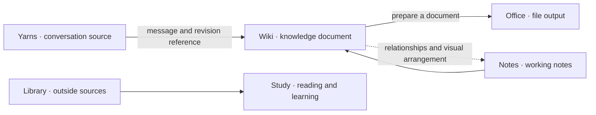

# PAW — Personal AI Workflow

A modular personal AI workspace for keeping conversations, notes and documents useful beyond the moment they were made.

[한국어](README.ko.md) · [Design notes](docs/DESIGN.md) · [Author](https://github.com/juho-kim-dev)

I started PAW because useful material was scattered across chats, notes, browser tabs and files. Finding an answer again often meant losing its context; moving it into a document meant making another copy to maintain.

PAW brings that work into **Spaces**: specialist web applications that can stand on their own. The aim is to carry a source, its context and its revision through the work, from a conversation to a note, from a note to a wiki page, and from a page to a finished document.

**Personal AI Workflow** is the project name. **Personal AI Workspace** describes the kind of software it is. This repository holds the public introduction and design record; application source is being prepared separately.

## Try the Spaces

These five Spaces are the current demo work. Status checked on 30 October 2026.

| Space | What it is for | Demo status |
| --- | --- | --- |
| [Notes](https://paw-notes.nonamegptpro.chatgpt.site/) | Write notes, follow links and arrange ideas | Public; sample notes, browser-local storage and reset |
| [Office](https://paw-office.nonamegptpro.chatgpt.site/) | Work on HWP and HWPX documents | Public; document work stays in the browser |
| [Yarns](https://paw-yarns.nonamegptpro.chatgpt.site/) | Keep conversations, search them and return to a particular message | Public; read and search sample conversations without signing in |
| [Wiki](https://paw-wiki.nonamegptpro.chatgpt.site/) | Write and connect knowledge, with a home for the PAW Spaces | Public; demo edits stay in the browser |
| [Study](https://paw-study.nonamegptpro.chatgpt.site/) | Read documents side by side and keep study notes and vocabulary | Public; two sample papers, with Korean translations for their first two pages |

Yarns offers a read-only sample library; signing in opens a separate personal library. Notes starts with five example notes and keeps each browser’s changes separate. Study's remaining pages are available in the original language; automatic translation is not connected. Browser-local changes are not shared with other visitors or synced across devices.

## The wider workspace

The following Spaces describe the direction of PAW. They are not additional public demos.

| Space | Role |
| --- | --- |
| Library | Collect and organize outside sources: articles, media, references and open-source projects. Keep enough context to investigate them later. |
| Boards | Gather pins into visual collections for comparison, planning and reference. |
| Forum | Discuss a document or idea through posts and replies, alongside preserved community material. |
| Git | Work with repositories, issues and development projects. A Gitea-based workspace is being explored. |
| Studio | Edit images, video and audio. A future Space. |

The visual workspace discussed as Canvas is represented here by the current Notes app. Notes already includes links, a graph and a basic canvas; richer diagrams and workflow views remain development directions.

## How the pieces fit

**Spaces** organize work. **Tools** provide actions such as reading, editing, searching or drawing a graph. **Objects** are the records those actions refer to: a conversation, a message, a document, a file or a discussion. **Core** is the intended set of shared rules for identity, references, revisions and access.

An object should keep its identity when it appears in another Space. A wiki page citing a conversation should point to the saved conversation and revision. Analysis, translations and edit proposals should remain distinguishable from the original.

This is the intended workflow, not a diagram of completed integrations. Each application currently has its own storage and permissions. Shared contracts are still being worked out; a single database is not a requirement. [Read the design notes](docs/DESIGN.md).

## Engineering work behind PAW

The applications are developed with AI assistance. My work includes deciding behavior, extending existing software, connecting browser and AI tool interfaces, and checking what survives a save, retry or conflict.

- **Conversation archives:** keep source revisions and stable message links; resume collection without importing the same material twice.
- **Knowledge editing:** tie an edit proposal to its base revision, so stale work cannot silently overwrite a newer page.
- **Note recovery:** preserve an unsaved draft, check the original version before restoring it, and retain conflicting work separately.
- **Document editing:** use the same document operations from the interface and AI tools, then reopen saved HWPX files to check the result.

These capabilities belong to different application implementations. They are not all available in the public demos. Existing document checks include an eight-page, sixteen-cell HWPX example; that is a bounded test, not a claim of complete format compatibility.

The stack varies by application: TypeScript and JavaScript, React, Node.js, Cloudflare Workers and SQLite/D1, with MCP and WebMCP where supported. Office builds on an existing open-source HWP/HWPX editor. Source releases need their own upstream attribution, licenses, setup instructions and reproducible checks.

## Next steps

Make the five demos useful to visitors and publish their source with clear setup and attribution. The first cross-Space workflow to establish is a conversation reference in Wiki, a revision-aware edit proposal, and a document that Office can save and reopen.

Personal archives, private conversations and deployment credentials stay out of the public repository and demos. The repository keeps its existing `personal-ai-workspace` name so existing links remain valid.
