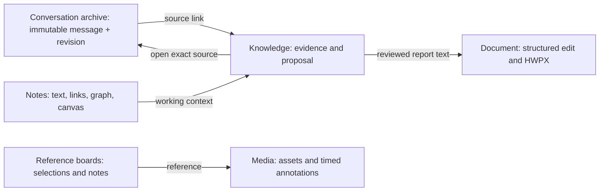

# Six roles, linked by explicit context

PAW's underlying applications are independent. Each keeps its own storage, lifecycle and capabilities. The knowledge role organizes evidence and reviews; it is not a universal database or an all-powerful server. This public demo deliberately composes selected capabilities in one static UI so a visitor can try the workflow without an account.

## Public boundaries

| Boundary | Current implementation |
| --- | --- |
| UI | React shell in `src/app.tsx`, existing graph and canvas components, original public assets |
| Domain behavior | Selected production modules in `components/`; public-only composition in `src/domain.ts` |
| Browser state | `sessionStorage` for this tab's notes, canvas, knowledge and board state; independent immutable `localStorage` draft records for unsaved notes |
| Documents | In-memory patched MIT WASM engine; disposable staged document per edit; HWPX download after reopen checks; no uploads |
| Media | Same-origin authored SVG/WebM; original carousel, player, corpus matching logic; authored time annotations |
| MCP | Local stdio adapter reads immutable public fixtures; does not access browser edits, private accounts or a remote model |
| Hosting | Static files; no database, storage bucket, sign-in, secrets or background jobs required |

The browser demo's aggregate session object is an adapter, not a proposal to merge the private applications' databases. The public MCP adapter does **not** claim the full private applications' write capabilities. `read_documents` describes the public document contract; it does not parse the currently open browser document.

## Decisions carried into this publication

- Preserve source text, order, stable identities and revision-bearing links. A summary is a derivative, never a replacement for the original.
- Keep observations, claims, issues, proposals and adopted changes distinguishable. Seeing a new source creates a review candidate; it does not automatically establish a contradiction or change a report.
- Bind a proposal to its document version. Reject a stale proposal. Make repeated application of the same request idempotent.
- Preserve unsaved note drafts before acknowledging edits. Recovery records do not expire automatically; reading a draft is not permission to overwrite a newer document.
- Use the same validated document operations for higher-level editing. Stage a batch on disposable bytes and reject a failing batch before committing.
- Treat image captions, comments, OCR and transcripts as separate evidence. Missing content stays unknown. Authored annotations in this demo are never labeled model output.
- Distinguish remotely readable archives from collection workers. A remote reader can be available while a local collector is offline; this static demo does not run either service.
- Keep public role names and synthetic fixtures independent of private product names, accounts and records.

## Reuse versus new work

Existing: source search/link helpers; note metadata, graph, canvas and recovery modules; knowledge input contract; board validation; media matching and controls; structured document editing, export checks and patched WASM.

New: this role-based UI, cross-role exhibition scenario, session storage adapter, knowledge demo transitions, read-only public MCP adapter, build/transfer scripts, original assets, tests and evidence documentation. These adapters do not replace production authentication, D1 transactions, collectors or collaboration services.

## Further development

1. Deploy this verified static build from the secondary account and record the actual URL and deployed commit.
2. Add a public source-preserving import fixture runner with deterministic checkpoints, cancellation and resume tests. Exclude real account authentication and raw captured conversations.
3. Publish a separate server-backed reference for revision checks, ownership and bounded reader continuation; prove concurrency and recovery before claiming a multi-user service.
4. Add actual MCP write integration through the same services only after scopes, conflict behavior and audit receipts are exercised. The current MCP is read-only.
5. Extend document fixtures and independent parser comparisons before broadening compatibility claims. Publish reproducible engine build steps separately from the included reviewed binary.

These are remaining work, not features already deployed by this PR. SWU is outside this repository's scope.
